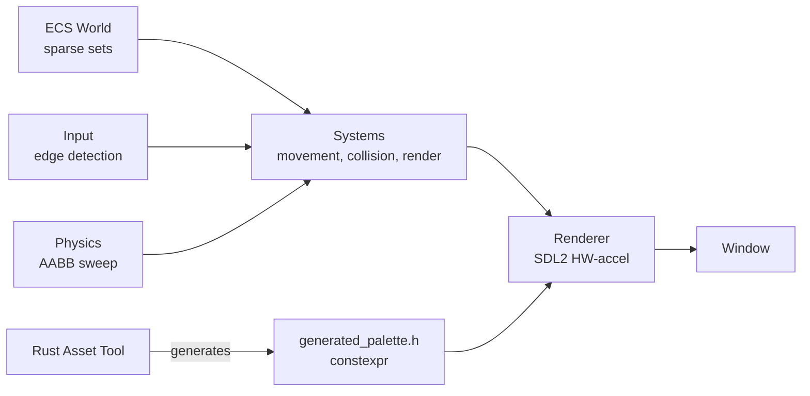

<div align="center">


</div>

<div align="center">

# 🔨 ForgeEngine

**A minimal 2D game engine in C++20 with a Rust asset-toolchain bridge**

[](https://github.com/cokovali10-sketch/ForgeEngine/actions/workflows/ci.yml)
[](#)
[](#)
[](#)
[](#)
[](#)
[](#)

</div>

<div align="center">



<i>Demo platformer: ECS · AABB sweep physics · SDL2 rendering · Rust asset bridge</i>

</div>

**ForgeEngine** is a compact, cleanly-architected 2D game engine written in modern C++20. It demonstrates a real **ECS (Entity-Component-System)** core, hardware-accelerated SDL2 rendering, AABB physics with sweep collision, input handling, and a cross-language **C++ ↔ Rust toolchain** that generates C++ asset code from Rust. Built to be readable, testable, and a strong portfolio piece.

## ✨ Features

| Module | Description |
|---|---|
| ⚙️ **ECS core** | Sparse-set component storage, generation-versioned entity handles, O(1) add/remove/get |
| 🖼️ **Renderer** | SDL2 hardware-accelerated drawing: filled rects, outlines, lines, per-frame clears |
| 📐 **Math** | `Vec2`, `Rect`, `Color` — clean constexpr primitives |
| 🧲 **Physics** | AABB sweep collision (X-then-Y separation) with penetration resolution |
| ⌨️ **Input** | Keyboard state with edge-detection (`pressed` / `released` / `down`) |
| 🎮 **Demo game** | Playable platformer: player, gravity, jumping, platforms, FPS counter |
| 🔗 **C++ ↔ Rust bridge** | Rust CLI generates a `constexpr` color palette header consumed by C++ |

## 🎮 Demo Preview

| Feature | Implementation |
|---|---|
| **Movement** | WASD / Arrow keys + Space to jump |
| **Physics** | Gravity, AABB sweep collision, ground/ceiling/wall resolution |
| **Rendering** | Sprites, starfield background, per-frame FPS in window title |
| **Assets** | Colors generated by Rust tool → `constexpr` C++ header |

## 🧱 Architecture

```
include/forge/
├── ecs/          entity.h · storage.h (sparse set) · world.h
├── math/         vec2.h · rect.h
├── graphics/     window.h · renderer.h · sprite.h
├── physics/      aabb.h
├── input/        input.h
├── systems/      movement.h · collision.h · render.h
└── assets/       generated_palette.h  ← generated by Rust tool

src/              implementation of the above
tools/            Rust: forge-asset-tools (asset code generator)
examples/demo/    platformer demo (main.cpp)
tests/            ecs_test.cpp · physics_test.cpp
```

**Data-oriented design:** components live in packed, cache-friendly dense arrays; entities are just indices + generation counters; systems iterate storage directly.

## 🚀 Building

### Requirements
- **C++20 compiler** (GCC 13+ / Clang / MSVC)
- **CMake 3.20+** and a generator (Ninja / Makefiles)
- **SDL2** development libraries
- **Rust** (only for the asset toolchain)

### Configure & build

```bash
cmake -S . -B build -G Ninja -DCMAKE_BUILD_TYPE=Release
cmake --build build
```

### Run the demo

```bash
./build/bin/demo.exe              # platformer: WASD/arrows + Space to jump
./build/bin/demo.exe --screenshot out.bmp  # auto-capture screenshot after settling
```

### Run tests

```bash
ctest --test-dir build --output-on-failure
```

### Regenerate assets (Rust)

```bash
cd tools
cargo run --release -- ../include/forge/assets/generated_palette.h
```

This shows the cross-language flow: **Rust owns asset data → generates C++ → engine consumes it at compile time** (`constexpr`).

## 🧪 Tests

| Test | Coverage |
|---|---|
| `ecs_test` | Entity lifecycle, versioning, component CRUD, `each()` iteration |
| `physics_test` | `Vec2` math, `Rect` overlap, AABB sweep resolution & normals |

## 🛠️ CI / CD

GitHub Actions workflow (`.github/workflows/ci.yml`) runs on every push:
- **Ubuntu build** with Ninja + SDL2
- **C++ tests** (ecs_test, physics_test)
- **Rust toolchain** build + palette generation verification

## 🗺️ Roadmap

- [x] ECS core + rendering + AABB sweep physics + input
- [x] Demo platformer with FPS counter
- [x] Rust asset toolchain (C++ ↔ Rust bridge)
- [ ] Texture loading (PNG via SDL_image)
- [ ] Audio (SDL_mixer)
- [ ] Camera & tilemap rendering
- [ ] Animation system

---

<div align="center"><i>Small core, clean systems, real results.</i></div>